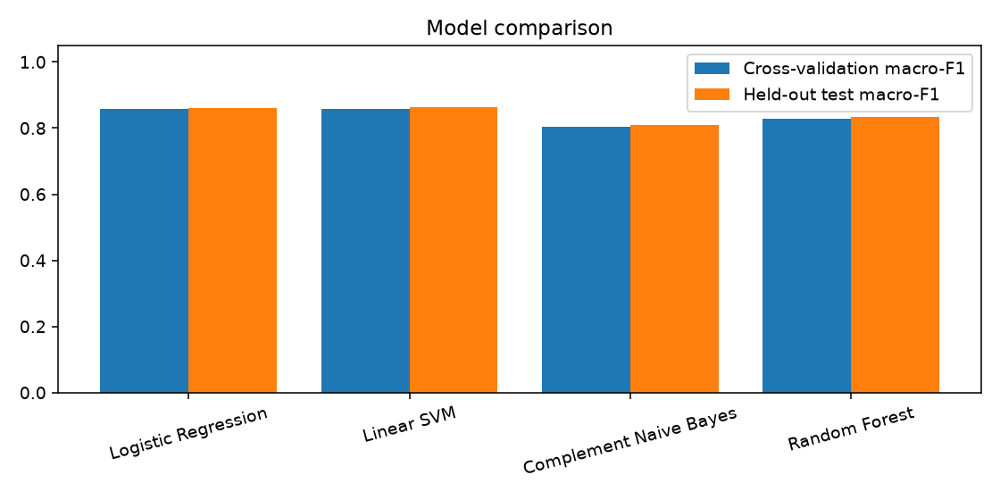
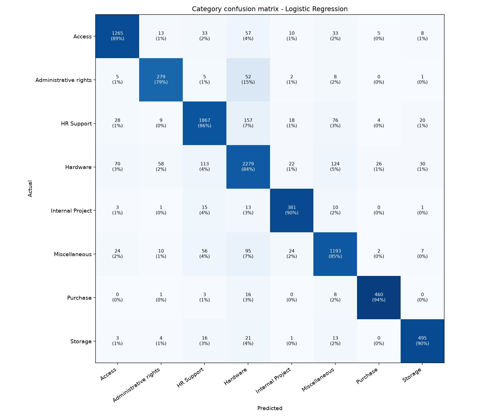

# Evaluation report

*Dataset:* Kaggle - IT Service Ticket Classification (`all_tickets_processed_improved_v3.csv`) - 47762 tickets after cleaning (38209 train / 9553 test, stratified split, seed 42).

## 1. Category model comparison

Models are ranked by cross-validated macro-F1 on the training set; the test set is touched only once, after the winner is chosen.

| Model | CV macro-F1 | Test accuracy | Test macro-F1 | Time (s) |
|---|---|---|---|---|
| Logistic Regression **(selected)** | 0.858 +/- 0.004 | 0.860 | 0.862 | 38.9 |
| Linear SVM | 0.857 +/- 0.004 | 0.862 | 0.862 | 15.5 |
| Complement Naive Bayes | 0.805 +/- 0.000 | 0.817 | 0.809 | 10.1 |
| Random Forest | 0.827 +/- 0.004 | 0.836 | 0.834 | 122.4 |

## 2. Selected model: Logistic Regression

| Category | Precision | Recall | F1 | Support |
|---|---|---|---|---|
| Access | 0.905 | 0.888 | 0.897 | 1424 |
| Administrative rights | 0.744 | 0.793 | 0.768 | 352 |
| HR Support | 0.886 | 0.857 | 0.871 | 2179 |
| Hardware | 0.847 | 0.837 | 0.842 | 2722 |
| Internal Project | 0.832 | 0.899 | 0.864 | 424 |
| Miscellaneous | 0.814 | 0.845 | 0.830 | 1411 |
| Purchase | 0.926 | 0.943 | 0.934 | 488 |
| Storage | 0.881 | 0.895 | 0.888 | 553 |

Overall test accuracy **0.860**, macro-F1 **0.862**.

Most frequent confusion: **HR Support -> predicted as Hardware** (157 tickets).

### Most indicative words per category

| Category | Top words |
|---|---|
| Access | confluence, user, card, password, license, account, git, repository |
| Administrative rights | outlook, upgrade, issues, install, windows, software, version, update |
| HR Support | access, oracle, time, error, starter, leave, leaver, submit |
| Hardware | monitor, laptop, room, connection, phone, calls, ram, meeting |
| Internal Project | code, project, pipeline, codes, setup, pas, pipelines, import |
| Miscellaneous | change, approval, approve, add, tickets, ticket, groups, owner |
| Purchase | po, purchase, installation, device, administrator, log, devices, order |
| Storage | folder, mailbox, storage, shared, wants, folders, permissions, files |

### Confidence and human review

Tickets with confidence >= 50% are auto-routed: **89%** of the test set, with accuracy **0.904**. Tickets below the threshold are flagged for a human; accuracy there is 0.493.

## 3. Priority

No priority labels in this dataset, so the rule engine alone decides priority. Distribution on the test set: {'Medium': 1382, 'High': 282, 'Low': 7823, 'Critical': 66}
